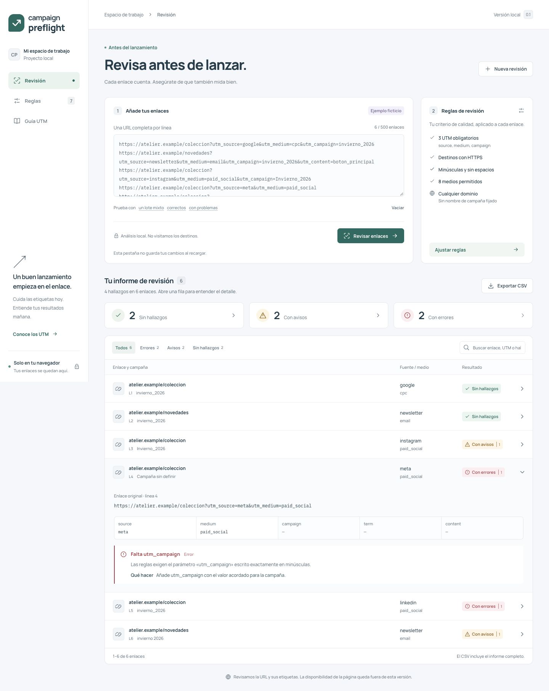

# Campaign Preflight

Herramienta local para revisar enlaces de campañas de marketing antes de publicarlos. Analiza la estructura de las URLs, los parámetros UTM y los destinos permitidos, y genera un informe con hallazgos y sugerencias que se puede exportar a CSV.

El análisis se ejecuta en el navegador. No visita las páginas de destino ni envía los enlaces a servicios externos. **«Sin hallazgos» significa que el enlace cumple las reglas activas; no confirma que la página exista, esté disponible o mida conversiones correctamente.**



## Funciones

- Revisión de un lote de URLs HTTP/HTTPS, con una URL por línea.
- Detección de UTM ausentes, vacíos, duplicados, con mayúsculas, espacios o codificación dañada, y UTM colocados en fragmentos.
- Configuración de UTM obligatorios, HTTPS, medios permitidos, dominios, subdominios y campaña esperada.
- Informe con errores, avisos, explicaciones y sugerencias; búsqueda y filtros por estado.
- Paginación de 50 enlaces y exportación del informe completo a CSV.
- Aviso de informe desactualizado cuando cambian los enlaces o las reglas efectivas.
- Deshacer un reemplazo de enlaces o un restablecimiento de reglas durante la sesión.
- Guía UTM en español y ejemplos ficticios para probar la herramienta.

## Requisitos

- Node.js **26 recomendado**. Versiones admitidas: `^22.22.2 || ^24.15.0 || >=26.0.0`, según `package.json`.
- npm y un navegador moderno.
- Acceso a npm para instalar las dependencias. Una vez instaladas, el análisis no necesita conexión; las fuentes se sirven desde el proyecto.

No requiere claves API, variables de entorno, cuentas de terceros, backend ni base de datos. No necesita un archivo `.env` ni `.env.example`.

## Instalación y arranque

```bash
git clone https://github.com/TommyHavana/campaign-preflight.git
cd campaign-preflight
npm ci
npm run dev
```

Abre **http://127.0.0.1:5173** y mantén la terminal abierta mientras usas la aplicación. Para detenerla, pulsa `Ctrl+C`.

Si utilizas nvm, ejecuta `nvm use` antes de instalar; `.nvmrc` selecciona Node 26. Si no lo utilizas, basta con tener instalada una versión de Node admitida.

El servidor escucha solo en la interfaz local. Si el puerto está ocupado, ejecuta `npm run dev -- --port 5174` y abre la dirección que indique Vite.

## Comandos de desarrollo

| Comando                | Función                                                   |
| ---------------------- | --------------------------------------------------------- |
| `npm run dev`          | Inicia el servidor local de desarrollo.                   |
| `npm test`             | Ejecuta las pruebas del analizador, CSV e interfaz.       |
| `npm run test:watch`   | Ejecuta las pruebas en modo observación.                  |
| `npm run typecheck`    | Comprueba los tipos sin generar archivos.                 |
| `npm run build`        | Comprueba TypeScript y genera la compilación en `dist/`.  |
| `npm run check`        | Ejecuta las pruebas, TypeScript y la compilación.         |
| `npm run format:check` | Comprueba el formato sin modificar archivos.              |
| `npm run format`       | Aplica el formato de Prettier.                            |
| `npm run preview`      | Sirve la compilación de `dist/` en http://127.0.0.1:4173. |

Para una previsualización de producción local, ejecuta primero `npm run build` y después `npm run preview`. Si el puerto está ocupado, usa `npm run preview -- --port 4174`.

Generar `dist/` o publicar este repositorio no despliega la aplicación. No hay despliegue ni servicios de pago configurados.

## Cómo usarlo

1. Abre **Revisión**. La aplicación incluye un lote ficticio para explorar los resultados.
2. Pega tus enlaces, uno por línea, o carga ejemplos correctos, incorrectos o mixtos.
3. En **Reglas**, ajusta los UTM obligatorios, las convenciones de escritura y los destinos permitidos.
4. Pulsa **Revisar enlaces** para generar un informe con esas entradas y reglas.
5. Filtra o busca resultados. La búsqueda incluye los UTM decodificados y los textos de los hallazgos: puedes buscar `otoño` aunque la URL contenga `oto%C3%B1o`. Despliega una fila para leer qué se detectó, por qué importa y cómo corregirlo.
6. En lotes largos, recorre las páginas de 50 enlaces. Cambiar de búsqueda o filtro vuelve a la primera página.
7. Exporta el CSV para conservar o compartir el informe completo, incluidos los enlaces correctos. Ni la página visible ni los filtros de pantalla recortan la exportación.

Al cambiar los enlaces o el significado de las reglas, el informe anterior queda desactualizado y su exportación se desactiva hasta volver a analizar. Cambiar el orden de una lista, sus separadores o sus espacios exteriores no invalida un informe si conserva las mismas reglas. Así no se confunde un informe anterior con una revisión de los nuevos datos.

**Deshacer** recupera un paso después de vaciar, iniciar una nueva revisión, cargar un ejemplo o restablecer las reglas. Restaura enlaces, configuración e informe anteriores. Es una recuperación en memoria: editar posteriormente los enlaces o las reglas descarta ese paso, y una nueva acción reemplaza al anterior.

Los errores de configuración se muestran junto al campo afectado. Los campos de identificadores desactivan autocorrección y autocapitalización para conservar los valores exactos. La interfaz incluye foco visible de teclado, nombres accesibles en las filas y controles auxiliares de al menos 44 px de alto en móvil.

La aplicación no conserva los datos al recargar. El CSV es la forma de guardar el resultado de esta versión.

## Qué se comprueba

Las convenciones UTM dependen del equipo. Algunas plataformas aceptan valores que tu equipo preferirá evitar; por eso las reglas se pueden ajustar y los hallazgos distinguen errores y advertencias.

| Comprobación         | Comportamiento                                                                                                                                   |
| -------------------- | ------------------------------------------------------------------------------------------------------------------------------------------------ |
| URL válida           | Requiere una URL absoluta HTTP o HTTPS; no completa automáticamente dominios ni modifica el enlace original.                                     |
| URL inequívoca       | Detecta espacios sin codificar, barras invertidas, codificación `%` incompleta y credenciales incluidas en la URL.                               |
| Codificación legible | Detecta Unicode incompleto y codificación UTF-8 dañada en nombres de parámetros o valores UTM. Conserva la URL original.                         |
| HTTPS                | Obligatorio por defecto; configurable.                                                                                                           |
| UTM obligatorios     | `utm_source`, `utm_medium` y `utm_campaign` por defecto; también puedes exigir `utm_term` y `utm_content`. Un valor vacío no satisface la regla. |
| Escritura de UTM     | Detecta nombres con mayúsculas, duplicados y problemas de ubicación en el fragmento `#`.                                                         |
| Otros UTM            | Avisa si un parámetro `utm_` no pertenece a los cinco parámetros que cubre esta versión; puede ser una extensión válida o una errata.            |
| Valores de UTM       | Por defecto avisa sobre mayúsculas y espacios; ambas convenciones son configurables.                                                             |
| Medios permitidos    | Lista configurable. Valores iniciales: `cpc`, `paid_social`, `email`, `organic`, `referral`, `social`, `display` y `affiliate`.                  |
| Dominios permitidos  | Lista opcional de nombres de host. La coincidencia es exacta; puedes activar la aceptación de sus subdominios.                                   |
| Campaña esperada     | Valor opcional para comprobar que los enlaces pertenecen a la campaña que estás revisando.                                                       |
| Enlaces repetidos    | Avisa si el lote contiene la misma URL, aunque cambie el orden entre nombres de parámetros de consulta.                                          |

Para limitar destinos, introduce dominios como `tienda.example.com`, sin esquema ni ruta. Autorizar `example.com` no autoriza `example.com.otro.test`; activar subdominios sí permite `tienda.example.com`.

Una lista vacía de medios o dominios desactiva esa restricción. Los medios y la campaña esperada se comparan de forma exacta, incluidas las mayúsculas. Los UTM obligatorios deben tener su nombre en minúsculas: `UTM_SOURCE` genera un aviso de escritura y no sustituye a `utm_source`.

Una campaña esperada exige `utm_campaign` aunque no esté marcado como obligatorio. Si además es obligatorio y falta, aparece un único hallazgo que explica el valor esperado. Dejar el campo vacío desactiva esta regla; introducir solo espacios es una configuración inválida.

Los UTM en fragmentos se detectan también en rutas de aplicaciones como `#/oferta?utm_source=boletin`. Un `?` que ya forma parte del valor de otro parámetro del fragmento no se interpreta como el comienzo de una nueva consulta. Las comprobaciones UTF-8 se limitan a nombres de parámetros y valores UTM; no fuerzan esa codificación en rutas ni en valores de otros parámetros.

El destino mostrado contiene el protocolo, el host, el puerto si existe y la ruta. Omite consulta y fragmento para facilitar la lectura; la URL original completa se conserva por separado. No es una URL final resuelta después de redirecciones.

Los estados del informe son:

- **Con errores:** hay al menos un incumplimiento que requiere corrección según las reglas.
- **Con avisos:** no hay errores, pero hay convenciones o detalles que conviene revisar.
- **Sin hallazgos:** no se detectan hallazgos con las reglas actuales.

Cada hallazgo tiene un código, un campo, una explicación y una sugerencia. Un enlace puede contener varios hallazgos; su estado resume el de mayor gravedad.

El lote admite hasta **500 enlaces**, **8.192 caracteres por URL** y **1.000.000 de caracteres de entrada**. Las líneas vacías se ignoran. Si se supera un límite, se muestra un error y no se analiza un lote recortado. Los límites evitan cargas accidentales excesivas en una herramienta que procesa todo en el navegador.

## UTM, explicado con un ejemplo

```text
https://tienda.example.com/zapatillas?utm_source=boletin&utm_medium=email&utm_campaign=invierno_2026&utm_content=boton_principal
```

| Parámetro      | Pregunta que responde                           | Ejemplo                          |
| -------------- | ----------------------------------------------- | -------------------------------- |
| `utm_source`   | ¿Qué fuente envía el tráfico?                   | `boletin`, `google`, `instagram` |
| `utm_medium`   | ¿Qué tipo de canal se utiliza?                  | `email`, `cpc`, `paid_social`    |
| `utm_campaign` | ¿A qué campaña pertenece?                       | `invierno_2026`                  |
| `utm_term`     | ¿Qué palabra clave o segmento se diferencia?    | `zapatillas_trail`               |
| `utm_content`  | ¿Qué pieza, ubicación o variante se diferencia? | `boton_principal`                |

La consistencia importa: `Invierno_2026` e `invierno_2026` pueden terminar separados en una herramienta de analítica. Este proyecto ayuda a encontrar esas diferencias antes de publicar; no atribuye visitas ni se conecta a una plataforma de medición.

Ejemplos deliberadamente incorrectos:

```text
http://tienda.example.com/zapatillas?utm_source=Boletin&utm_medium=email&utm_campaign=invierno%202026
https://tienda.example.com/zapatillas?utm_source=boletin&utm_campaign=invierno_2026
https://tienda.example.com/zapatillas?utm_source=boletin&utm_source=crm&utm_medium=email&utm_campaign=invierno_2026
https://tienda.example.com/zapatillas#utm_source=boletin&utm_medium=email&utm_campaign=invierno_2026
```

Con las reglas iniciales, el primero presenta HTTP, mayúsculas y un espacio en la campaña; el segundo omite `utm_medium`; el tercero repite `utm_source`; el cuarto coloca los UTM en el fragmento en lugar de la consulta. Los dominios `.example.com` son ficticios y no requieren visitar ninguna página para probar las reglas.

Puedes copiar más lotes desde `examples/` o usar los botones de ejemplos de la interfaz. El lote mixto representa a la marca ficticia `atelier.example`: contiene seis enlaces que, con las reglas iniciales, producen dos resultados correctos, dos advertencias y dos errores.

## Exportación y privacidad

La exportación genera un CSV descargable en el navegador con una fila por hallazgo y una fila por cada enlace correcto. Sus columnas contienen línea de origen, URL original, destino, estado, severidad, campo, código, explicación, sugerencia y los cinco UTM. Los estados se exportan como `correcto`, `aviso` o `error`. Si un UTM se repite, se conservan todos sus valores en una lista JSON dentro de la celda.

El archivo utiliza UTF-8 con BOM, comas como separador y saltos de línea CRLF. Todos los campos van entre comillas y las comillas internas se duplican. Los valores que podrían iniciar una fórmula de hoja de cálculo se neutralizan con un apóstrofo inicial, incluso si empiezan por espacios. Si tu hoja de cálculo espera punto y coma, importa el archivo seleccionando la coma como delimitador.

No hay backend, base de datos, autenticación, cookies de seguimiento ni persistencia local. Los enlaces y las reglas permanecen en la memoria de la pestaña hasta que la cierres o recargues. Un CSV puede contener información sensible que ya estuviese en las URLs; revisa su contenido antes de compartirlo.

## Arquitectura y decisiones

La separación principal está entre **reglas de dominio** y **presentación**. El analizador recibe texto y reglas, y devuelve un informe sin acceder a la red ni al DOM. Esto permite probar el comportamiento de marketing sin depender de botones o estilos.

React mantiene el estado de la interfaz: entradas, reglas, informe y filtros. El informe se guarda junto a las entradas y la firma de reglas con las que se calculó. `src/state/settings.ts` transforma los campos editables en reglas y calcula una firma de sus valores efectivos. TypeScript describe esos datos y evita discrepancias entre el analizador, la interfaz y el exportador.

Vite aporta el servidor local y la compilación. Vitest prueba las reglas y el CSV; React Testing Library y jsdom permiten probar comportamientos de la interfaz, como Deshacer y el bloqueo de exportaciones desactualizadas. La búsqueda usa valores UTM ya decodificados, normalización Unicode NFC y comparación sin distinguir mayúsculas. El diseño utiliza CSS propio y fuentes incluidas en las dependencias.

Esta versión no necesita un framework de servidor, un gestor global de estado ni una base de datos: no tiene sesiones, datos compartidos ni operaciones remotas. Añadirlos ahora aumentaría el mantenimiento sin mejorar la revisión de enlaces. La utilidad del producto está en ofrecer un informe explicable y accionable; no depende de IA ni de servicios externos.

```text
campaign-preflight/
├── docs/                     # AUDIT.md y capturas de verificación local
├── examples/                 # Lotes ficticios para copiar y pegar
├── public/favicon.svg        # Icono local
├── src/
│   ├── data/examples.ts      # Ejemplos usados en la aplicación
│   ├── components/
│   │   ├── Guide.tsx         # Guía de UTM y convenciones
│   │   ├── Icon.tsx          # Iconos de la interfaz
│   │   ├── ReportView.tsx    # Resultados, filtros y detalle
│   │   ├── ReportView.test.tsx # Búsqueda, paginación y accesibilidad de filas
│   │   └── RulesEditor.tsx   # Edición de las reglas
│   ├── domain/
│   │   ├── types.ts          # Reglas, resultados, valores iniciales y límites
│   │   ├── analyze.ts        # Análisis puro de enlaces y convenciones
│   │   ├── analyze.test.ts   # Casos de las reglas principales
│   │   ├── csv.ts            # Serialización y escape para exportar
│   │   └── csv.test.ts       # Pruebas de integridad y seguridad del CSV
│   ├── state/settings.ts    # Conversión de campos y firma de reglas efectivas
│   ├── App.tsx              # Revisión, reglas, guía y estado de la interfaz
│   ├── App.test.tsx         # Reanálisis, límites, errores y Deshacer
│   ├── main.tsx             # Punto de entrada de React
│   ├── vite-env.d.ts        # Tipos del entorno Vite y recursos importados
│   └── styles.css           # Estilos y adaptación a pantallas pequeñas
├── .gitignore
├── .nvmrc
├── index.html
├── package.json
├── package-lock.json        # Versiones resueltas para npm ci
├── tsconfig.json
├── vite.config.ts
├── README.md
└── STATUS.md                # Estado, verificación y trabajo pendiente
```

## Limitaciones

- No comprueba códigos HTTP, DNS, certificados, tiempos de carga, redirecciones, etiquetas de analítica ni conversiones.
- Los enlaces, las reglas y el paso de Deshacer permanecen únicamente en memoria y se pierden al recargar o cerrar la pestaña.
- El lote admite hasta **500 enlaces**, **8.192 caracteres por URL** y **1.000.000 de caracteres de entrada**. Superar un límite rechaza el lote sin recortarlo.
- Las reglas UTM expresan convenciones configurables; no representan una especificación universal de las plataformas de analítica.
- La exportación contiene los datos incluidos en las URLs. Revisa el CSV antes de compartirlo.
- No incluye importación de CSV, perfiles persistentes, autenticación ni comparación de informes.

## Verificación y documentación

Para repetir las comprobaciones disponibles:

```bash
npm run check
npm run format:check
npm audit
```

La suite incluye pruebas del motor de reglas, del exportador CSV y de los flujos de interfaz con React Testing Library y jsdom. Los resultados de la revisión inicial se conservan, fechados, en [STATUS.md](STATUS.md) y [docs/AUDIT.md](docs/AUDIT.md). Las capturas de `docs/` muestran ejemplos ficticios de esa revisión.

Las posibles ampliaciones incluyen perfiles de reglas persistentes, importación de archivos y comprobación de disponibilidad o redirecciones. No forman parte de esta versión. Consultar destinos requeriría resolver las restricciones CORS y, si se añade un servidor, protegerlo frente a SSRF.

## Archivos privados y generados

El repositorio incluye el código, las pruebas, las fuentes de configuración, `package-lock.json`, los ejemplos ficticios y la documentación. `.gitignore` excluye dependencias instaladas, compilaciones, cobertura, archivos `.env` y configuración privada, claves, bases de datos locales, exportaciones y temporales. Revisa siempre lo que vas a añadir a Git: las exclusiones no eliminan secretos ya registrados en el historial.

## Licencia

Este proyecto todavía no tiene una licencia de uso o distribución elegida. No se incluye un archivo `LICENSE`.
